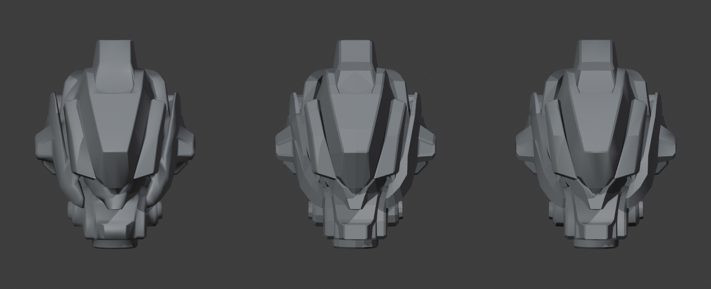

# Head mesh: restoring hard surfaces in Blender

Inspected 24 October 2026 in Blender 5.2.2 LTS. Source: `F:\Assets\Protoype_Mech\Head\robotic head 3d model.fbx`, generated with Tripo according to the owner. Exact generator model, prompt and export settings were not supplied.

The head needs both a shading correction and some targeted geometry work. The imported mesh has 1,053 vertices, 1,236 faces and 2,075 triangles. All faces are smooth shaded, imported custom normals are present, and no edges are marked sharp. There are no modifiers causing the rounding. Its cheek guards and outer shell also have rounded geometry, so normals alone cannot reproduce the flat armor planes of the reference.

[Download comparison image](head-shading-front.png) | [Editable Blender comparison](head-shading-comparison-v001.blend) | [Inspection data](inspection.json)

Left to right: **original imported normals**, **flat shading diagnostic**, **smooth shading with edges sharper than 30 degrees split**. The two test copies have their imported custom normals cleared. Their vertex positions and face connectivity match the original exactly; only shading and display position differ. Flat shading exposes uneven panel faces and coarse transitions. The 30 degree test restores edge contrast but is deliberately a diagnostic starting point, not an accepted finished repair.

## First: correct the shading

1. Duplicate the head with **Shift+D**, then right-click to leave the duplicate in place. Hide the original for comparison.
2. On the copy, use **Object > Shade Flat**. This reveals which apparent curves are caused by interpolated lighting. Undo this diagnostic before setting up the final shading.
3. This FBX includes custom normals. If angle-based shading still looks smeared, clear those on the working copy: open **Object Data Properties** (green triangle), expand **Geometry Data**, then click **Clear Custom Normals Data**. This is the exact button label verified in the installed Blender 5.2.2 LTS; do not rely on F3 search in the 3D Viewport to find this Properties-panel command.
4. Use **Object > Shade Auto Smooth**. In the resulting **Smooth by Angle** modifier, start at **30 degrees** and compare around **30–45 degrees**. Smaller values create more shading breaks; excessive splitting exposes every uneven face.
5. For intentional panel boundaries, select those edges in Edit Mode and use **Ctrl+E > Mark Sharp**. Keep **Ignore Sharpness** disabled in Smooth by Angle. This is more selective than splitting every edge globally.

Shading changes the lighting across the existing mesh; it does not move vertices or straighten a curved outline. [Blender shading documentation](https://docs.blender.org/manual/en/latest/scene_layout/object/editing/shading.html).

## Then: straighten the armor geometry

For this head, prioritize the outer cheek guards, central face/nose block and broad upper shell panels. Keep intended joint and neck curves smooth.

- For an existing panel that should be planar, select only its interior surface vertices and flatten them along the panel's normal. For an axis-aligned plane this is **S, axis, 0**; a sloped panel needs a suitable custom transform orientation first. Avoid including the bevel strip or adjacent panels in the selection.
- Where Tripo fused parts together or rounded away the intended corner, rebuild that armor plate as a simple separate mesh over the imported head. Use the original as a shape guide and the supplied front PNG as the design guide. Model one side and mirror where appropriate. The front reference does not establish exact rear geometry.
- After the planes and silhouette are right, add a **small Bevel** to rebuilt plates: start around **0.5–1% of that part's width**, **1–2 segments**, limited to intended edges. Apply scale before tuning the bevel. This width is a starting point, not an established physical dimension.
- A **Weighted Normal** modifier can improve reflections across broad flat faces, especially on rebuilt beveled plates. It cannot flatten curved geometry. [Blender Weighted Normal documentation](https://docs.blender.org/manual/en/latest/modeling/modifiers/normals/weighted_normal.html).

Avoid global subdivision or smoothing to solve this issue; they move the result further toward rounded forms. Global decimation or a large bevel will not reconstruct the reference's missing armor boundaries. Work on the individual panels that matter to the silhouette.

## Review and next step

Recommended route: preserve the Tripo source, correct its shading, then rebuild only the large armor panels that remain too soft. A complete head rebuild has not been established as necessary. The supplied PNG has much finer panel, vent, fastener and material detail than this low-resolution mesh; a shading change cannot recover those features.

Acceptance checks for a later repair: broad armor planes read flat, intended edge highlights are narrow, cheek/upper-shell outlines match the reference in front view, joints retain useful roundness, and three-quarter views show no pinching or accidental gaps. Then check normals and scale in Unity.

The editable comparison preserves the untouched imported head and two shading tests. No vertices were repositioned and no source FBX was overwritten. The inspection also found 25 boundary or otherwise non-manifold edges; these need review before treating the asset as a clean production mesh. No Unity import, final topology repair, materials, UVs or engine validation were performed. The imported mesh contains no UV maps.
